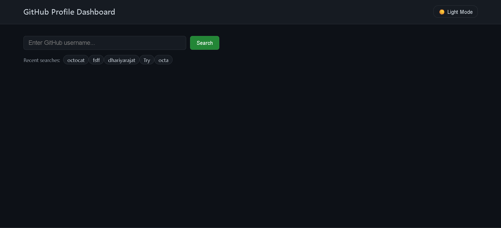
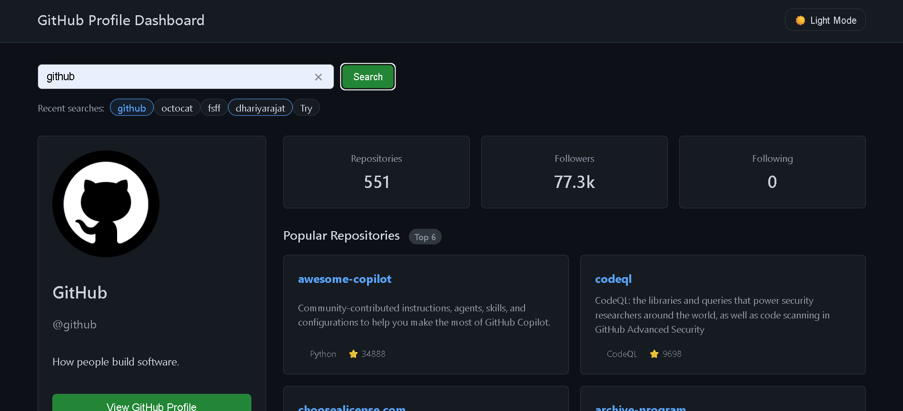
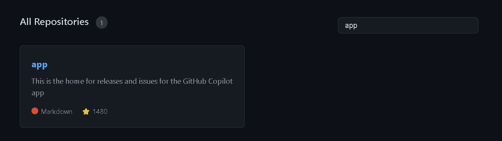
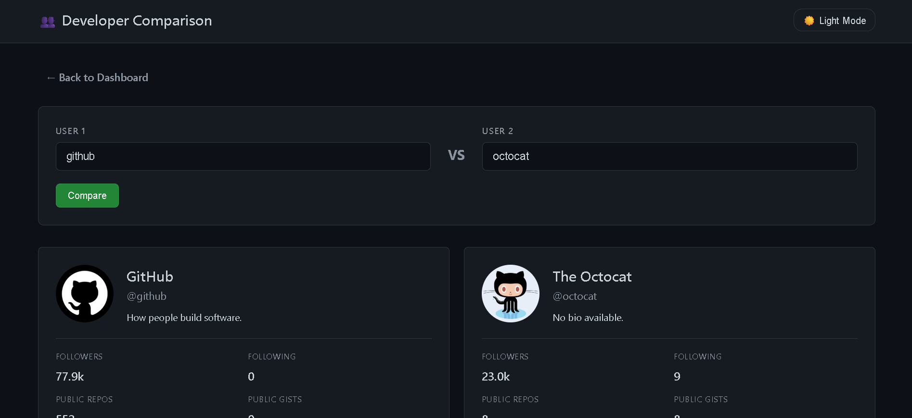

# 🚀 GitHub Profile Dashboard

A modern GitHub Profile Dashboard built using HTML, CSS, Tailwind CSS, and JavaScript. The application fetches real-time GitHub user data and repository information using the GitHub REST API.

## 🌐 Live Demo

Add your Vercel deployment link here.

```bash
https://your-project.vercel.app
```

---

## 📸 Screenshots

### Home Page



### Profile Dashboard




### Repository Search & Filter



### Developer Comparison



---

## ✨ Features

### 👤 GitHub Profile Search

* Search any GitHub username
* Real-time GitHub API integration
* Display profile details instantly

### 📊 Profile Analytics

* Avatar
* Name
* Username
* Bio
* Followers
* Following
* Public Repositories
* Location
* Company
* Join Date

### 📦 Repository Dashboard

* Repository listing
* Repository descriptions
* Programming language display
* Stars count
* Last updated information

### 🔍 Repository Filtering

* Search repositories instantly
* Dynamic filtering

### ⭐ Repository Sorting

* Sort repositories by popularity
* Sort based on GitHub stars

### ⚡ Loading States

* Professional loading indicators
* Better user experience during API requests

### ❌ Error Handling

* Empty input validation
* User not found handling
* API failure handling
* Network error handling

### 🕒 Recent Searches

* Stores previously searched usernames
* Quick access to recent profiles

### ⚔️ Developer Comparison

Compare two GitHub developers side-by-side.

Features:

* User comparison
* Followers comparison
* Following comparison
* Public repositories comparison
* Public gists comparison
* Total stars comparison
* Top 5 repositories comparison
* Most popular repository comparison

### 🏆 Developer Ranking System

Automatic winner calculation based on:

* Followers
* Public Repositories
* Public Gists
* Total Repository Stars

### 🔗 URL Parameter Support

Examples:

```bash
compare.html?user1=dhariyarajat&user2=torvalds
```

Directly opens the comparison page with users preloaded.

### 📱 Responsive Design

* Mobile friendly
* Tablet friendly
* Desktop optimized

---

## 🛠️ Tech Stack

### Frontend

* HTML5
* CSS3
* Tailwind CSS
* JavaScript (ES6+)

### APIs

* GitHub REST API

### Concepts Used

* Async/Await
* Fetch API
* DOM Manipulation
* Event Handling
* Local Storage
* URLSearchParams
* Array Methods
* Error Handling
* Responsive Design

---

## 📂 Project Structure

```bash
project/
│
├── index.html
├── profile.html
├── compare.html
│
├── css/
│   └── style.css
│
├── js/
│   ├── main.js
│   ├── profile.js
│   ├── compare.js
│
└── assets/
```

---

## 🚀 Installation

Clone the repository:

```bash
git clone https://github.com/your-username/github-profile-dashboard.git
```

Open the project:

```bash
cd github-profile-dashboard
```

Run with VS Code Live Server or deploy using Vercel.

---

## 🎯 What I Learned

This project helped me learn:

* Real-world API integration
* Asynchronous JavaScript
* DOM manipulation
* Dynamic UI rendering
* Error handling
* State management
* GitHub API usage
* Frontend project architecture

---

## 🔮 Future Improvements

* GitHub Contribution Graph
* Advanced Analytics
* User Favorites
* Export Reports
* Theme Customization
* Repository Insights Dashboard

---

## 👨‍💻 Developer

**Rajat Dhariya**

BCA Student | Frontend Developer | Aspiring Full Stack Developer

Interested in:

* Web Development
* AI-Powered Applications
* JavaScript Development
* Full Stack Engineering

---

⭐ If you like this project, consider giving it a star.
